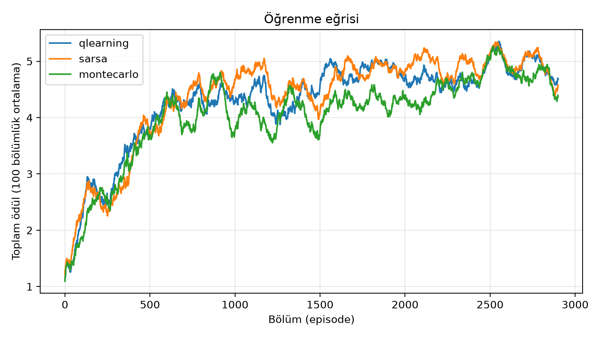
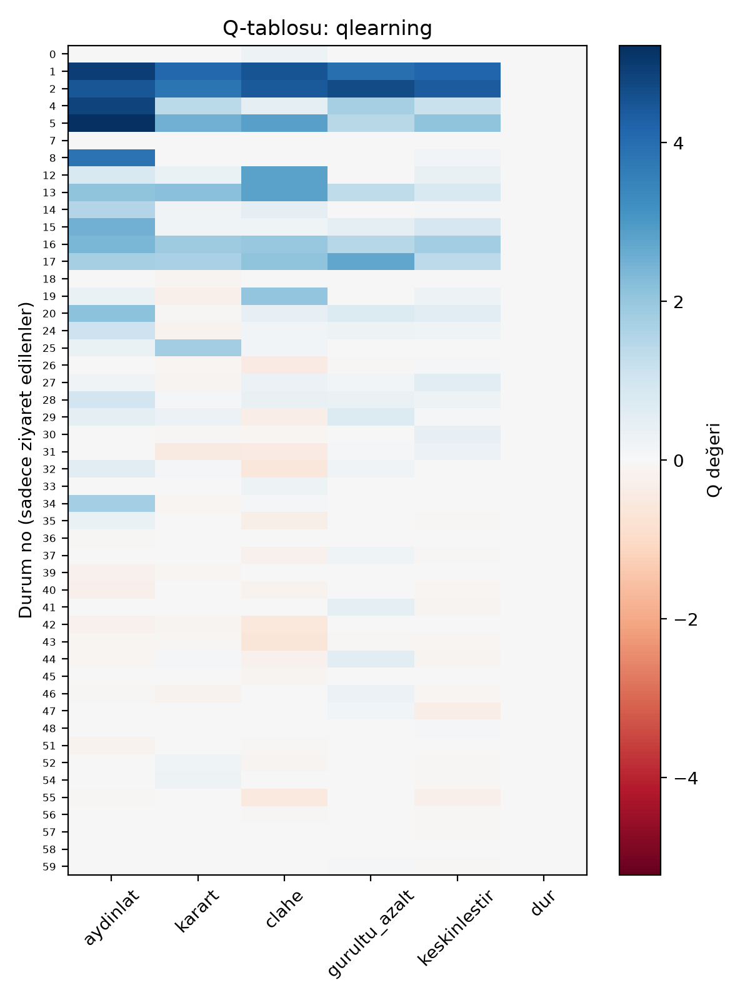
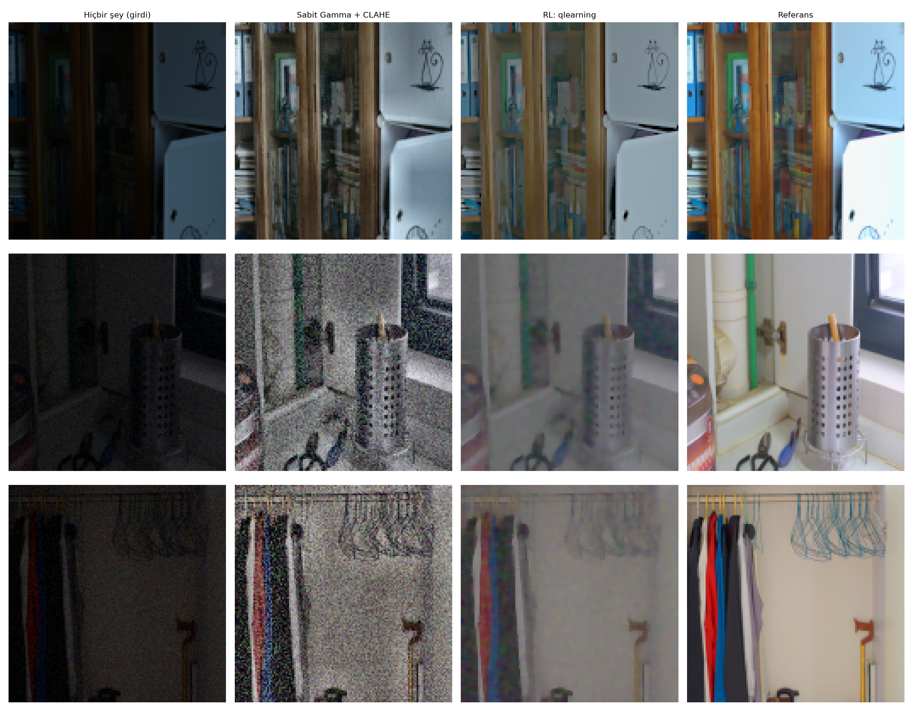
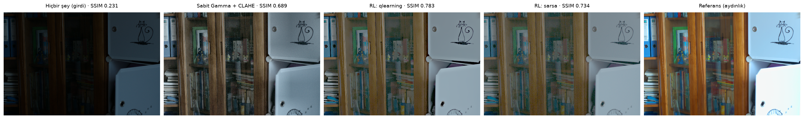
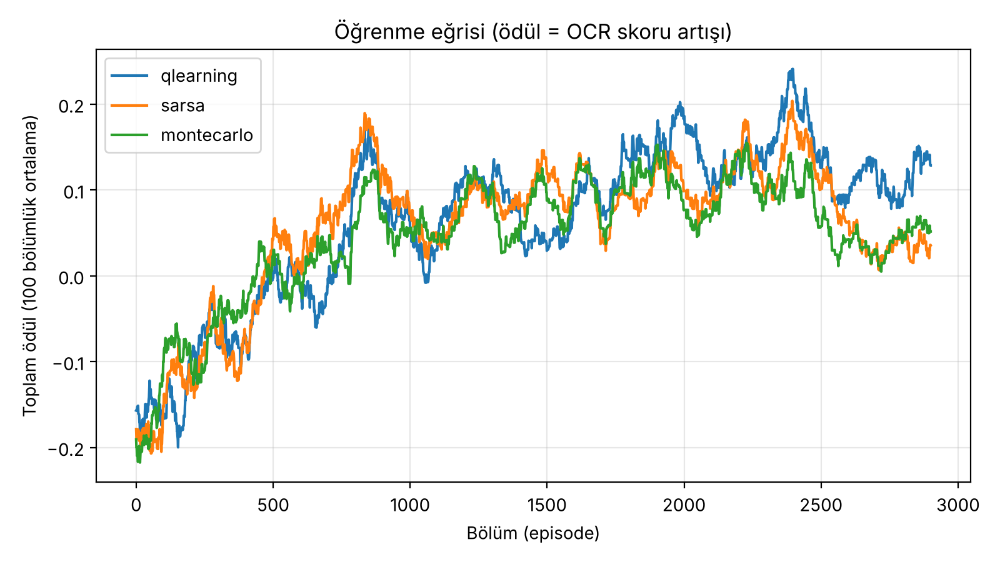
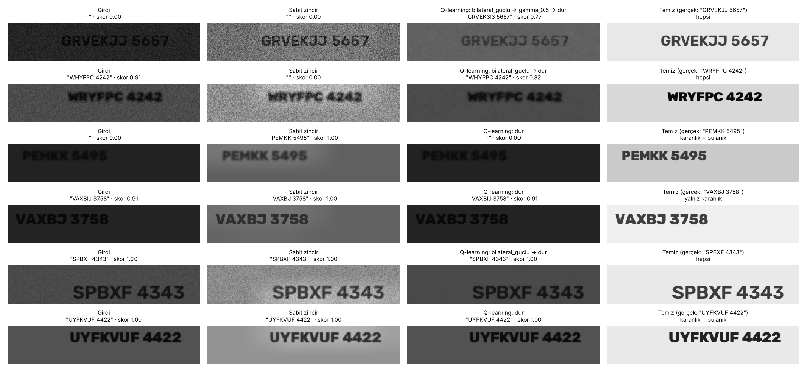

# Bozuk Görüntüyü Adım Adım İyileştirme: Tablo Tabanlı Pekiştirmeli Öğrenme

*Derin Pekiştirmeli Öğrenme dersi dönem projesi*

## Özet
Karanlık ve gürültülü görüntülerin iyileştirilmesinde genellikle gamma düzeltme ve CLAHE gibi işlemler belirli bir sırayla uygulanır. Ancak bu işlemlerin her görüntüde aynı sonucu vermesi beklenemez. Bu projede, görüntünün özelliklerine göre uygun iyileştirme işlemini ve uygulama sırasını seçebilen bir pekiştirmeli öğrenme ajanı geliştiriyoruz.

Ajan, görüntünün parlaklık, kontrast ve gürültü seviyelerini değerlendirerek altı eylemden birini seçiyor: beş klasik görüntü işleme yöntemi ve "dur". Elde edilen sonuç, aydınlık referans görüntüyle SSIM üzerinden karşılaştırılıyor ve iyileşme miktarına göre ajan ödüllendiriliyor. Projede derin öğrenme ağı yerine Q-learning, SARSA ve Monte Carlo algoritmalarıyla bir Q-tablosu oluşturuluyor. Geliştirilen ajanların performansı LOL veri seti üzerinde sabit bir filtre zinciri (Gamma + CLAHE), histogram eşitleme ve rastgele seçim yapan bir ajanla karşılaştırılıyor. Q-learning ve SARSA ajanları, SSIM'de en iyi sabit yöntemi yaklaşık 0,10 farkla geçiyor (0,71'e karşı 0,61). Onaylanan konudaki asıl hedef OCR başarısı olduğu için, ödülü doğrudan Tesseract OCR'nin okuma doğruluğu olan ikinci bir deney de ekledik (sentetik yazı görüntüleri, 9 filtre/parametre eylemi, 72 durum). Bu deneyde Q-learning ajanı 100 test görüntüsünde ortalama OCR skorunu 0,890'a çıkarıyor; hiç işlem yapmamak 0,772, sabit Gamma + CLAHE zinciri ise 0,662 veriyor.

## 1. Giriş
- Problem: düşük ışıkta çekilmiş görüntüleri iyileştirme
- Neden sıralı karar problemi? Filtrelerin sırası sonucu değiştirir (ör. önce aydınlatıp sonra gürültü azaltmak ≠ tersi)
- Neden tablo tabanlı RL? Durum uzayı küçük tutulabilir, öğrenilen politika tablodan okunup yorumlanabilir

## 2. Yöntem

### 2.1 Markov karar süreci (MDP)

| Bileşen | Tanım |
|---|---|
| Durum *s* | (parlaklık, kontrast, gürültü) özellikleri aralıklara bölünür: 5 × 4 × 3 = **60 durum** |
| Eylem *a* | `aydinlat` (γ=0,6), `karart` (γ=1,25), `clahe`, `gurultu_azalt` (bilateral), `keskinlestir` (unsharp mask), `dur` |
| Ödül *r* | 10 · (SSIM<sub>sonra</sub> − SSIM<sub>önce</sub>) − 0,01 (adım cezası) |
| Bölüm sonu | `dur` eylemi ya da 5 adım |

### 2.2 Algoritmalar
- **Q-learning:** Q(s,a) ← Q(s,a) + α [r + γ max<sub>a'</sub> Q(s',a') − Q(s,a)]
- **SARSA:** Q(s,a) ← Q(s,a) + α [r + γ Q(s',a') − Q(s,a)], burada a' gerçekten seçilen eylem
- **Monte Carlo:** Bölüm bitince her adım için gerçek getiri G hesaplanır, Q(s,a) ← Q(s,a) + α [G − Q(s,a)]
- Hepsinde ε-açgözlü keşif (ε: 1,0 → 0,05), α = 0,1, γ = 0,95

### 2.3 Karşılaştırma yöntemleri
Girdi (hiçbir şey yapmamak) · Rastgele ajan · Histogram eşitleme · Sabit Gamma + CLAHE · Aç gözlü kâhin (her adımda referansa bakarak en iyi eylemi seçer; gerçekte yapılamaz, **üst sınır** olarak verilir)

## 3. Deney düzeni
- Veri: LOL (Wei ve ark., 2018): 485 eğitim, 15 test çifti (600×400). Eğitim hız için 128×128'de yapıldı. Karanlık görüntülerin yarısına yapay Gauss gürültüsü eklendi.
- Tam çözünürlük: Durum her zaman 128×128'lik bir kopyadan hesaplandığı ve filtre parametreleri görüntü boyutuyla orantılı ölçeklendiği için, 128×128'de eğitilen Q-tablosu orijinal 600×400 görüntülere doğrudan uygulanabilir (`evaluate.py --tam`).
- Ölçütler: PSNR, SSIM, ortalama adım sayısı
- Eğitim: 3000 bölüm

## 4. Sonuçlar

### 4.1 Test seti (128×128)
LOL eval15, 15 görüntü. Ajanlar 3000 bölüm eğitildi; testte keşif kapalı (ε = 0).

| Yöntem | PSNR ↑ | SSIM ↑ | Ort. adım |
|---|---|---|---|
| Girdi (işlem yok) | 7,83 | 0,161 | 0,0 |
| Rastgele ajan | 9,84 | 0,335 | 3,1 |
| Histogram eşitleme | 13,91 | 0,506 | 1,0 |
| Sabit Gamma + CLAHE | 14,70 | 0,610 | 2,0 |
| **RL: Q-learning** | 15,91 | 0,713 | 3,8 |
| **RL: SARSA** | **16,33** | **0,714** | 3,6 |
| **RL: Monte Carlo** | 14,96 | 0,682 | 2,9 |
| Açgözlü kâhin (üst sınır) | 18,83 | 0,754 | 3,9 |

Üç RL ajanı da en iyi sabit yöntemi (Gamma + CLAHE) geçiyor: SSIM'de Q-learning ve SARSA +0,10, Monte Carlo +0,07. Açgözlü kâhin her adımda referans görüntüye bakarak en iyi eylemi seçtiği için gerçekte uygulanamaz; ulaşılabilecek üst sınırı göstermek için verildi.

### 4.2 Orijinal çözünürlük (600×400)
Aynı Q-tabloları, yeniden eğitilmeden orijinal boyuttaki görüntülere uygulandı (`evaluate.py --tam`).

| Yöntem | PSNR ↑ | SSIM ↑ | Ort. adım |
|---|---|---|---|
| Girdi (işlem yok) | 7,77 | 0,173 | 0,0 |
| Rastgele ajan | 9,47 | 0,276 | 3,1 |
| Histogram eşitleme | 13,98 | 0,334 | 1,0 |
| Sabit Gamma + CLAHE | 13,69 | 0,440 | 2,0 |
| **RL: Q-learning** | 15,55 | **0,575** | 3,7 |
| **RL: SARSA** | **15,64** | 0,558 | 3,5 |
| **RL: Monte Carlo** | 14,30 | 0,526 | 2,8 |
| Açgözlü kâhin (üst sınır) | 17,46 | 0,692 | 4,5 |

Bütün yöntemlerin SSIM'i orijinal boyutta düşüyor, ama sıralama korunuyor ve RL ile sabit yöntem arasındaki fark büyüyor (Q-learning +0,135).

### 4.3 Öğrenme eğrisi



500 bölümlük dilimlerde ortalama toplam ödül:

| Bölüm | 1–500 | 501–1000 | 1001–1500 | 1501–2000 | 2001–2500 | 2501–3000 |
|---|---|---|---|---|---|---|
| Q-learning | 2,51 | 4,23 | 4,33 | 4,79 | 4,66 | 4,93 |
| SARSA | 2,43 | 4,29 | 4,62 | 4,70 | 4,91 | 4,95 |
| Monte Carlo | 2,33 | 4,14 | 4,04 | 4,17 | 4,48 | 4,80 |

Ödül ilk 1000 bölümde hızla artıyor, sonra yavaşça düzleşiyor. ε yaklaşık 1500. bölümde alt sınırı olan 0,05'e iniyor. Monte Carlo en yavaş yükselen yöntem.

### 4.4 Öğrenilen politika (Q-tablosu)



60 durumdan 48'i eğitim sırasında ziyaret edildi. Karanlık durumlarda (parlaklık aralığı 0–1, durum 0–23) en yüksek değer çoğunlukla **aydınlat** eyleminde. Aydınlık durumlarda (durum 36 ve sonrası) filtrelerin değeri 0'a yakın ya da negatif. Test görüntülerinin en sık vardığı durumlarda (39, 40, 42, 43) en iyi eylem **dur**. Diğer aydınlık durumlarda küçük pozitif değerlerle gürültü azaltma (ör. 44) ya da en parlak aralıkta karartma (ör. 52, 54) öne çıkıyor. Test setinde en sık eylem dizileri:

| Ajan | 128×128 | 600×400 |
|---|---|---|
| Q-learning | gürültü azalt → aydınlat → aydınlat → dur | aydınlat → aydınlat → dur |
| SARSA | aydınlat → aydınlat → dur | aydınlat → aydınlat → dur |
| Monte Carlo | gürültü azalt → aydınlat → aydınlat → dur | aydınlat → aydınlat → dur |
| Sabit yöntem | aydınlat → CLAHE (her görüntüde aynı) | aydınlat → CLAHE |

### 4.5 Örnek görüntüler



Orijinal çözünürlükte, ölçeklenmeden (girdi · Gamma + CLAHE · Q-learning · SARSA · referans):



Bütün test görüntüleri için: [`results/tam/`](results/tam/)

## 5. Tartışma

**Ajan ne öğrendi?** Q-tablosuna bakınca ajanın öğrendiği şey aslında oldukça sezgisel. Görüntü karanlıkken neredeyse her durumda en yüksek değer "aydınlat" eyleminde. Karanlık ve gürültülü durumlarda (ör. durum 2) önce gürültü azaltmayı tercih ediyor; bu da mantıklı, çünkü önce aydınlatmak gürültüyü de büyütüyor. Yalnız bu tercih zayıf: durum 2'de gürültü azaltmanın değeri 4,66, aydınlatmanınki 4,46. Karanlık ve kontrastı düşük durumlarda (12, 13) CLAHE açık farkla öne çıkıyor. Görüntü yeterince aydınlandığında (testte en sık 39, 40, 42 ve 43 numaralı durumlar) bütün filtrelerin değeri negatif, ajan da duruyor: 15 test görüntüsünün 10'unda bölümü kendi "dur" kararıyla bitirdi, 5'inde adım sınırına ulaştı. En parlak aralıkta (durum 48 ve sonrası) ise bazı durumlarda küçük bir pozitif değerle "karart" öne çıkıyor; ajan fazla aydınlatmayı geri almayı da öğrenmiş. Yani ajan sadece "ne yapacağını" değil, "ne zaman bırakacağını" da öğrenmiş. Sabit Gamma + CLAHE zinciri bunu yapamıyor: her görüntüye aynı iki adımı uyguluyor.

**Üç yöntemin karşılaştırması.** Q-learning ve SARSA neredeyse aynı sonucu verdi (SSIM 0,713 ve 0,714). Bunu bekliyorduk: bölümler çok kısa (en fazla 5 adım) ve ε eğitimin ikinci yarısında 0,05'e indiği için iki yöntemin hedefleri arasındaki fark küçülüyor. Monte Carlo biraz geride kaldı (0,682) ve öğrenme eğrisi de daha yavaş yükseldi. Monte Carlo güncelleme için bölümün bitmesini bekliyor ve hedef olarak o bölümde gerçekten toplanan getiriyi kullanıyor. Bu getiri seçilen görüntüye ve keşif sırasında yapılan rastgele hamlelere çok bağlı, yani gürültülü. Aynı bölüm sayısında tablosu daha geç oturuyor.

**Ajan ile kâhin arasındaki fark.** Kâhin her adımda referansa bakarak seçim yaptığı için 0,754'e ulaşıyor; ajan 0,713'te kalıyor. Farkın ana nedeni durum tanımının kaba olması. 60 durum, birbirinden oldukça farklı görüntüleri aynı numaraya koyuyor. Örneğin eval15/1.png'de ajan 44 numaralı durumda gürültü azaltmayı seçti, çünkü o duruma düşen diğer görüntülerde bu işe yaramıştı; bu görüntüde ise SSIM hafifçe düştü. Eğitimi uzatmak bu farkı kapatmıyor: ödül 2000. bölümden sonra zaten düzleşiyor. Farkı kapatmanın yolu durumu zenginleştirmek (daha fazla aralık ya da yeni özellikler), ama bu tabloyu büyütüyor ve her hücrenin öğrenilmesi için daha çok bölüm gerekiyor.

**Çözünürlük.** Ajan 128×128'de eğitildi ama orijinal 600×400 görüntülerde de sabit yöntemi geçti (0,575'e karşı 0,440). Orijinal boyutta bütün yöntemlerin SSIM'i düşüyor, çünkü küçültme gürültüyü yumuşatıyor; büyük görüntüde gürültü olduğu gibi duruyor. Kâhinle fark da orijinal boyutta büyüyor (0,575'e karşı 0,692). Bunun bir nedeni, ajanın durumu küçültülmüş kopyadan okuması ve büyük görüntüdeki gürültüyü olduğundan az görmesi olabilir.

**Sınırlılıklar.**
- Ödül için aydınlık referans görüntü gerekiyor. Eğitilmiş ajan referansa ihtiyaç duymuyor (sadece durumu kullanıyor), ama eğitim için aynı sahnenin karanlık ve aydınlık çiftleri şart.
- SSIM insan gözüyle birebir örtüşmüyor. SSIM'i yüksek bir sonuç göze her zaman en iyi görünen sonuç olmayabilir.
- Eylemler sabit ayarlı (ör. gamma hep 0,6). Ajan filtrenin gücünü ayarlayamıyor, sadece aynı filtreyi tekrar uygulayabiliyor.
- Durum tüm görüntünün ortalamasına bakıyor. Bir köşesi aydınlık, diğer köşesi karanlık bir görüntüyü ayırt edemiyor.
- Sadece LOL veri setinde denendi (iç mekân sahneleri); test seti 15 görüntü ve tek bir rastgele tohumla çalıştırıldı.

## 6. Sonuç
Bu projede karanlık görüntülere hangi filtrenin hangi sırayla uygulanacağını, 60 durumlu ve 6 eylemli küçük bir Q-tablosuyla öğrenen bir ajan geliştirdik. Derin ağ kullanmadan, yaklaşık 30 saniyelik bir eğitimle ajan, her görüntüye aynı işlemi uygulayan Gamma + CLAHE zincirini hem 128×128'de (SSIM 0,71'e karşı 0,61) hem de orijinal çözünürlükte (0,58'e karşı 0,44) geçti. Öğrenilen politika tablodan doğrudan okunabiliyor: karanlıkta aydınlat, gürültü varsa önce onu azalt, yeterince iyiyse dur. Yöntemin sınırı durum tanımının kabalığı; ileride durumun zenginleştirilmesi, ayarlanabilir eylemler ve referans gerektirmeyen bir ödül denenebilir.

## 7. İkinci deney: ödül olarak OCR başarısı

**Neden?** Onaylanan konu başlığında ajanın hedefi *OCR başarısını maksimize etmek*. Birinci deneydeki LOL veri setinde yazı ya da metin etiketi olmadığı için orada ödül olarak SSIM kullandık. Bu ikinci deneyde ödülü doğrudan OCR üretiyor: ajan karanlık, bulanık ve gürültülü bir yazı görüntüsüne sırayla hangi filtreyi hangi parametreyle uygulayacağını seçiyor, Tesseract metni ne kadar doğru okursa o kadar ödül alıyor. OCR motoru ajanın değil **ortamın** parçası; ajan yine yalnız bir Q-tablosu (klasik, tablo tabanlı RL). `src/agents.py` hiç değişmedi; yeni ortam (`src/ocr_env.py`) aynı arayüzü sunuyor.

| | |
|---|---|
| **Veri** | Sentetik, her çalıştırmada tohumla yeniden üretilir: 320×64 tek satır yazı, "5–7 harf + boşluk + 4 rakam" (O/I/Q ve 0/1 yok), açık düz zemin, koyu yazı, 4 Hershey yazı tipi, rastgele ölçek/kalınlık/konum. Temiz hâlini Tesseract'ın doğru okuyamadığı örnekler elenir. Bozma (her görüntüye bağımsız): Gauss bulanıklığı (σ 0,3–2,0; %40'ında yok) → karartma (×0,08–0,40) → Gauss gürültüsü (std 0,005–0,05; %40'ında yok) → 8 bit'e yuvarlama. Eğitim 400 (tohum 0), test 100 (tohum 123) |
| **Durum** | parlaklık (4) × kontrast (2) × gürültü (3) × keskinlik (Laplacian varyansı, 3) = **72 durum**. Sınırlar eğitim verisindeki dağılımın yüzdelik dilimlerinden seçildi |
| **Eylemler (9)** | gamma 0,5 · gamma 0,75 · CLAHE clip 2,0 · CLAHE clip 4,0 · bilateral hafif · bilateral güçlü · keskinleştir 0,6 · keskinleştir 1,5 · dur |
| **OCR skoru** | Tesseract 5 (`--psm 7`, eng, beyaz liste A–Z, 0–9, boşluk); skor = 1 − Levenshtein / max(uzunluk), 0–1 |
| **Ödül** | skor_sonra − skor_önce − 0,02 (adım cezası); "dur" = 0 ve bölüm biter; en fazla 5 adım |
| **Eğitim** | Birinci deneyle aynı ayarlar (α 0,1; γ 0,95; ε 1,0 → 0,05, çarpan 0,998; seed 0), 3000 bölüm, üç ajan paralel; 2 çekirdekte toplam ~12 dakika |

Ayar turu yapılmadı: durum sınırları ve adım cezası ilk hâliyle kullanıldı (eğitimde ödül her üç ajanda da negatiften pozitife çıktı).

**Sonuçlar** (test, 100 görüntü; temiz görüntülerin OCR skoru 1,000, çünkü temiz hâli okunamayanlar üretimde elendi):

| Yöntem | Ort. OCR skoru ↑ | Tam okuma ↑ | Ort. adım |
|---|---|---|---|
| Girdi (işlem yok) | 0,772 | %71 | 0,0 |
| Rastgele ajan | 0,600 | %50 | 3,2 |
| Sabit zincir (gamma 0,5 → CLAHE 2,0) | 0,662 | %62 | 2,0 |
| **RL: Q-learning** | **0,890** | **%82** | 0,8 |
| RL: SARSA | 0,827 | %74 | 0,8 |
| RL: Monte Carlo | 0,850 | %77 | 0,2 |
| Açgözlü kâhin (gerçek metne bakar; hileli üst sınır) | 0,954 | %88 | 0,3 |

Bozulma türüne göre ortalama OCR skoru:

| Bozulma | n | Girdi | Sabit zincir | Q-learning | SARSA | Monte Carlo | Kâhin |
|---|---|---|---|---|---|---|---|
| yalnız karanlık | 17 | 0,995 | 1,000 | 0,995 | 0,995 | 0,995 | 1,000 |
| karanlık + bulanık | 30 | 0,967 | 0,924 | 0,967 | 0,967 | 0,967 | 1,000 |
| karanlık + gürültülü | 23 | 0,818 | 0,637 | 0,964 | 0,839 | 0,934 | 0,978 |
| hepsi | 30 | 0,416 | 0,228 | 0,696 | 0,584 | 0,586 | 0,862 |





*Örnekler ajanın sabit zinciri geçtiği, geride kaldığı ve eşit kaldığı durumlardan ikişer tane (her gruptaki ilk iki test görüntüsü). Her panelin başlığında OCR'nin okuduğu metin ve skor var.*

**Yorum.** Q-learning ajanı ortalama OCR skorunu girdiye göre 0,12, sabit zincire göre 0,23 artırdı; üç ajan da hem girdiyi hem sabit zinciri geçti, ama hileli kâhinin (0,954) gerisinde kaldı. Şaşırtıcı bulgu, sabit Gamma + CLAHE zincirinin OCR'yi *düşürmesi*: Tesseract görüntüyü kendi içinde ikiliye çevirdiği için yalnız karanlık bir yazıyı zaten büyük ölçüde okuyabiliyor, aydınlatma ve CLAHE ise gürültüyü de büyütüyor. Ajan bunu öğrendi: test görüntülerinin %63'ünde hiçbir şey yapmadan duruyor, kazancın neredeyse tamamı gürültülü görüntülerde güçlü bilateral filtreyi (gerekirse ardından gamma 0,5'i) seçmesinden geliyor. Kâhinin de çoğunlukla hemen durması (%74), bu ortamda asıl sorunun karanlık değil gürültü olduğunu doğruluyor. Ajanın zayıf yanı da görselde görülüyor: kaba durum tanımı yüzünden OCR'nin hiç okuyamadığı bir görüntüde de (görseldeki PEMKK 5495, karanlık + bulanık) duruyor ve sabit zincirin tam okuttuğu örneği kaçırıyor.

**Sınırlılıklar.** (1) Veri sentetik: düz zemin, tek satır, Hershey yazı tipleri; gerçek fotoğraftaki yazılar (perspektif, doku, düzensiz ışık) daha zor. (2) Tek tohumla tek eğitim yapıldı; ajanlar arasındaki farkların bir kısmı rastlantısal olabilir (SARSA ve Monte Carlo'nun son 500 bölümdeki ödülü bir önceki dilime göre düştü). (3) Sonuçlar Tesseract sürümüne (burada 5.3.4) ve ayarlarına bağlı; başka bir sürüm aynı görüntüyü farklı okuyabilir. (4) OCR'nin kendisi klasik olmayan (LSTM tabanlı) bir bileşen; ancak ödülü üreten ortamın parçası, ajan değil; öğrenen kısım yalnız Q-tablosu. (5) OCR yavaş olduğu için ortam, aynı görüntüye aynı eylem dizisinin OCR skorunu bir kez hesaplayıp saklıyor (filtreler belirlenimci olduğundan sonucu değiştirmez). Tesseract'ın çöktüğü çok bozuk görüntüler "hiçbir şey okunamadı" sayılıyor.

## Çalıştırma

```bash
pip install -r requirements.txt
# LOL veri setini data/LOL/ altına koy (bkz. data/README.md)
python train.py --ajan hepsi --bolum 3000
python evaluate.py          # 128×128
python evaluate.py --tam    # orijinal 600×400; results/tam/ altında piksel piksel karşılaştırmalar
python demo.py --test 22    # tek bir test görüntüsünde ajanın adım adım kararları
python demo.py foto.jpg     # herhangi bir fotoğraf (referans gerekmez)

# İkinci deney (ödül = OCR başarısı); veri indirmeye gerek yok, sentetik üretilir
python train_ocr.py --ajan hepsi --bolum 3000
python evaluate_ocr.py
python demo_ocr.py --tohum 7                         # sentetik bir görüntüde adım adım
python demo_ocr.py yazi.png --metin "KITAP 4827"     # kendi görüntün (--metin isteğe bağlı)
python demo_ocr.py --yaz "ANKARA 2026" [--tohum 3]   # verdiğin metinden görüntü üret, boz, ajanı çalıştır
```

İkinci deney Tesseract OCR ister: Linux'ta `sudo apt install tesseract-ocr`, Windows'ta UB Mannheim kurulumu (github.com/UB-Mannheim/tesseract/wiki) ve kurulum klasörünü PATH'e ekleme.

Çıktılar `results/` (ikinci deney: `results_ocr/`) klasörüne yazılır.

## Klasör yapısı

```
src/env.py        ortam: durum, eylemler, ödül
src/agents.py     Q-learning, SARSA, Monte Carlo
src/baselines.py  karşılaştırma yöntemleri
src/data.py       LOL yükleme
train.py          eğitim
evaluate.py       test + tablolar + görseller
demo.py           tek görüntüde adım adım çalıştırma
src/ocr_env.py    ikinci deney: sentetik veri, bozma, filtreler, OCR ödülü, ortam
train_ocr.py      ikinci deney eğitimi
evaluate_ocr.py   ikinci deney test + tablolar + görseller
demo_ocr.py       ikinci deney: tek görüntüde adım adım çalıştırma
results_ocr/      ikinci deney çıktıları
notebooks/        adım adım anlatım
```

## Kaynaklar
- Sutton, R. S., & Barto, A. G. (2018). *Reinforcement Learning: An Introduction* (2. baskı). MIT Press.
- Wei, C., Wang, W., Yang, W., & Liu, J. (2018). Deep Retinex Decomposition for Low-Light Enhancement. *BMVC*.
- Watkins, C. J. C. H., & Dayan, P. (1992). Q-learning. *Machine Learning*, 8, 279–292.
