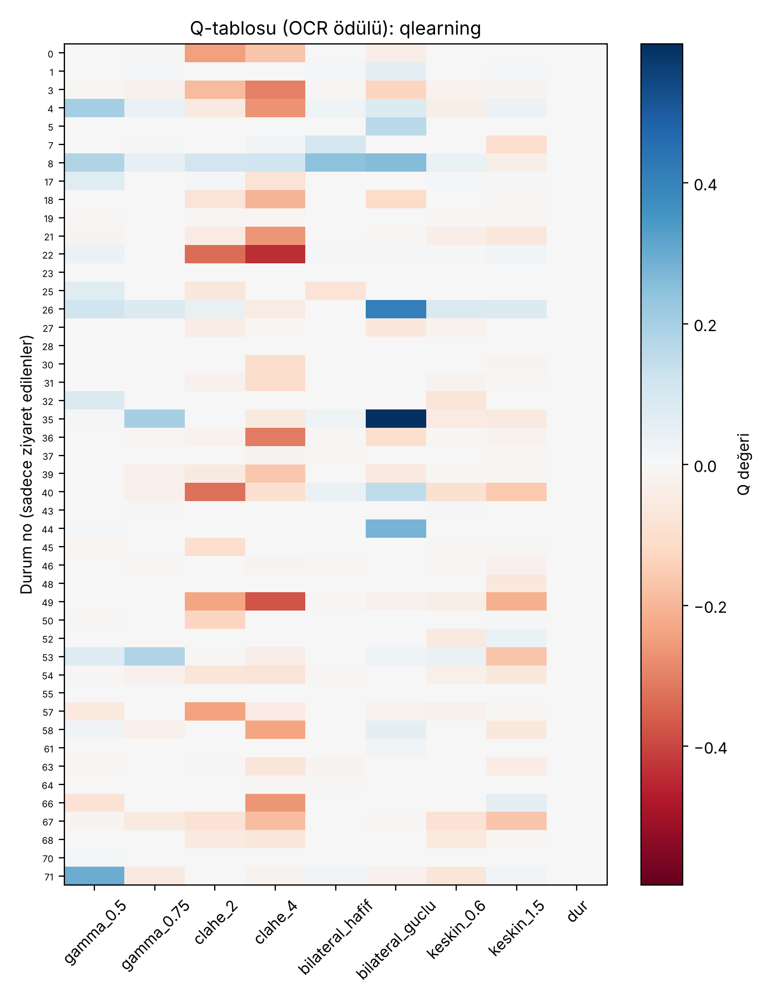

# Bozuk Görüntüyü Adım Adım İyileştirme: Tablo Tabanlı Pekiştirmeli Öğrenme ile OCR Başarısını Artırma

*Derin Pekiştirmeli Öğrenme dersi dönem projesi*

## Özet
Karanlık, bulanık ve gürültülü bir yazı görüntüsünü OCR'ye vermeden önce hangi filtrenin, hangi parametreyle, hangi sırayla uygulanacağı görüntüden görüntüye değişir; sabit bir filtre zinciri bazı görüntülerde işe yarar, bazılarında zarar verir. Bu projede, bu kararı görüntünün özelliklerine bakarak veren tablo tabanlı bir pekiştirmeli öğrenme ajanı geliştiriyoruz. Ajan 72 durumlu bir Q-tablosu kullanıyor ve 9 eylemden birini seçiyor (gamma düzeltme, CLAHE, bilateral filtre ve keskinleştirmenin ikişer ayarı ile "dur"). Ödülü doğrudan Tesseract OCR'nin okuma doğruluğu veriyor; OCR motoru ajanın değil ortamın parçası. Q-learning, SARSA ve Monte Carlo ile eğitilen ajanlar, sentetik olarak üretilmiş 100 test görüntüsünde sabit bir Gamma + CLAHE zinciri, hiçbir şey yapmamak ve rastgele seçimle karşılaştırılıyor. Q-learning ajanı ortalama OCR skorunu 0,890'a çıkarıyor; hiç işlem yapmamak 0,772, sabit Gamma + CLAHE zinciri ise 0,662 veriyor.

## 1. Giriş
Bu projenin konusu: ajan; karanlık, gürültülü ve bulanık bir görüntüye sırasıyla hangi OpenCV filtresini (gamma düzeltme, CLAHE, bilateral filtre, keskinleştirme) hangi parametreyle uygulayacağını seçerek OCR başarısını maksimize eder.

- Neden sıralı karar problemi? Filtrelerin sırası ve sayısı sonucu değiştirir; bir filtre gürültüyü de büyütebilir, bu yüzden "ne zaman bırakılacağı" da bir karardır.
- Neden tablo tabanlı RL? Durum uzayı küçük tutulabilir (72 durum), öğrenilen politika tablodan okunup yorumlanabilir.
- Neden OCR'yi ödül yapmak? Hedef görüntünün güzel görünmesi değil, yazının doğru okunması. Ödülü doğrudan OCR skorundan almak ajanı bu hedefe bağlar.
- Isınma: FrozenLake'te Q-learning (`notebooks/01_frozenlake_qlearning.ipynb`).

## 2. Yöntem

### 2.1 Markov karar süreci (MDP)

| Bileşen | Tanım |
|---|---|
| Durum *s* | parlaklık (4) × kontrast (2) × gürültü (3) × keskinlik (Laplacian varyansı, 3) = **72 durum**. Aralık sınırları eğitim verisindeki dağılımın yüzdelik dilimlerinden seçildi |
| Eylem *a* (9) | gamma 0,5 · gamma 0,75 · CLAHE clip 2,0 · CLAHE clip 4,0 · bilateral hafif · bilateral güçlü · keskinleştir 0,6 · keskinleştir 1,5 · `dur` |
| Ödül *r* | OCR skoru<sub>sonra</sub> − OCR skoru<sub>önce</sub> − 0,02 (adım cezası); `dur` = 0 |
| Bölüm sonu | `dur` eylemi ya da 5 adım |

OCR skoru: Tesseract 5 (`--psm 7`, eng, beyaz liste A–Z, 0–9, boşluk); skor = 1 − Levenshtein / max(uzunluk), 0–1 aralığında.

### 2.2 Algoritmalar
- **Q-learning:** Q(s,a) ← Q(s,a) + α [r + γ max<sub>a'</sub> Q(s',a') − Q(s,a)]
- **SARSA:** Q(s,a) ← Q(s,a) + α [r + γ Q(s',a') − Q(s,a)], burada a' gerçekten seçilen eylem
- **Monte Carlo:** Bölüm bitince her adım için gerçek getiri G hesaplanır, Q(s,a) ← Q(s,a) + α [G − Q(s,a)]
- Hepsinde ε-açgözlü keşif (ε: 1,0 → 0,05), α = 0,1, γ = 0,95

Ek ayrıntı: ε her bölümde 0,998 ile çarpılıyor, tohum 0.

### 2.3 Karşılaştırma yöntemleri
Girdi (hiçbir şey yapmamak) · Rastgele ajan · Sabit zincir (gamma 0,5 → CLAHE 2,0) · Açgözlü kâhin (her adımda gerçek metne bakarak en iyi eylemi seçer; gerçekte yapılamaz, **hileli üst sınır** olarak verilir)

## 3. Deney düzeni
- **Veri:** Sentetik, her çalıştırmada tohumla yeniden üretilir (dosya saklanmaz). 320×64 tek satır yazı, "5–7 harf + boşluk + 4 rakam" (O/I/Q ve 0/1 yok), açık düz zemin, koyu yazı, 4 Hershey yazı tipi, rastgele ölçek/kalınlık/konum. Temiz hâlini Tesseract'ın doğru okuyamadığı örnekler (test setinde 16) elenir.
- **Bozulmalar** (her görüntüye bağımsız): Gauss bulanıklığı (σ 0,3–2,0; %40'ında yok) → karartma (×0,08–0,40) → Gauss gürültüsü (std 0,005–0,05; %40'ında yok) → 8 bit'e yuvarlama.
- **Bölünme:** eğitim 400 görüntü (tohum 0), test 100 görüntü (tohum 123).
- **Tesseract ortamın parçası:** OCR yalnız ödülü ve skoru üretir; öğrenen kısım yalnız Q-tablosudur. OCR yavaş olduğu için ortam, aynı görüntüye aynı eylem dizisinin skorunu bir kez hesaplayıp saklıyor (filtreler belirlenimci olduğundan sonucu değiştirmez).
- **Eğitim:** 3000 bölüm, üç ajan paralel; 2 çekirdekte toplam ~12 dakika. Ayar turu yapılmadı: durum sınırları ve adım cezası ilk hâliyle kullanıldı. Testte keşif kapalı (ε = 0).
- Ölçütler: ortalama OCR skoru, tam okuma oranı, ortalama adım sayısı.

## 4. Sonuçlar

### 4.1 Test seti (100 görüntü)
Temiz görüntülerin OCR skoru 1,000 (temiz hâli okunamayanlar üretimde elendiği için).

| Yöntem | Ort. OCR skoru ↑ | Tam okuma ↑ | Ort. adım |
|---|---|---|---|
| Girdi (işlem yok) | 0,772 | %71 | 0,0 |
| Rastgele ajan | 0,600 | %50 | 3,2 |
| Sabit zincir (gamma 0,5 → CLAHE 2,0) | 0,662 | %62 | 2,0 |
| **RL: Q-learning** | **0,890** | **%82** | 0,8 |
| RL: SARSA | 0,827 | %74 | 0,8 |
| RL: Monte Carlo | 0,850 | %77 | 0,2 |
| Açgözlü kâhin (gerçek metne bakar; hileli üst sınır) | 0,954 | %88 | 0,3 |

En sık eylem dizisi: sabit zincirde gamma_0.5 → clahe_2 → dur (100/100); Q-learning, SARSA ve Monte Carlo ajanlarında dur (sırasıyla 63, 71 ve 81 görüntüde); kâhinde dur (74/100).

### 4.2 Bozulma türüne göre kırılım
Ortalama OCR skoru:

| Bozulma | n | Girdi | Sabit zincir | Q-learning | SARSA | Monte Carlo | Kâhin |
|---|---|---|---|---|---|---|---|
| yalnız karanlık | 17 | 0,995 | 1,000 | 0,995 | 0,995 | 0,995 | 1,000 |
| karanlık + bulanık | 30 | 0,967 | 0,924 | 0,967 | 0,967 | 0,967 | 1,000 |
| karanlık + gürültülü | 23 | 0,818 | 0,637 | 0,964 | 0,839 | 0,934 | 0,978 |
| hepsi | 30 | 0,416 | 0,228 | 0,696 | 0,584 | 0,586 | 0,862 |

### 4.3 Öğrenme eğrisi


Eğitimde ödül her üç ajanda da negatiften pozitife çıktı. SARSA ve Monte Carlo'nun son 500 bölümdeki ödülü bir önceki dilime göre düştü. Bölüm bazlı değerler `results_ocr/ogrenme_*.csv` dosyalarında.

### 4.4 Öğrenilen politika (Q-tablosu)



Q-tabloları (72 durum × 9 eylem) `results_ocr/Q_*.npy` dosyalarında, SARSA ve Monte Carlo için görseller `results_ocr/q_tablosu_sarsa.png` ve `results_ocr/q_tablosu_montecarlo.png` olarak bulunur. Testte Q-learning ajanı görüntülerin %63'ünde hiçbir şey yapmadan duruyor; kazancın neredeyse tamamı gürültülü görüntülerde güçlü bilateral filtreyi (gerekirse ardından gamma 0,5'i) seçmesinden geliyor.

### 4.5 Örnek görüntüler


*Örnekler ajanın sabit zinciri geçtiği, geride kaldığı ve eşit kaldığı durumlardan ikişer tane (her gruptaki ilk iki test görüntüsü). Her panelin başlığında OCR'nin okuduğu metin ve skor var.*

## 5. Tartışma

**Ajan ne öğrendi?** Q-learning ajanı ortalama OCR skorunu girdiye göre 0,12, sabit zincire göre 0,23 artırdı; üç ajan da hem girdiyi hem sabit zinciri geçti, ama hileli kâhinin (0,954) gerisinde kaldı. Şaşırtıcı bulgu, sabit Gamma + CLAHE zincirinin OCR'yi *düşürmesi*: Tesseract görüntüyü kendi içinde ikiliye çevirdiği için yalnız karanlık bir yazıyı zaten büyük ölçüde okuyabiliyor, aydınlatma ve CLAHE ise gürültüyü de büyütüyor. Ajan bunu öğrendi: test görüntülerinin %63'ünde hiçbir şey yapmadan duruyor, kazancın neredeyse tamamı gürültülü görüntülerden geliyor. Yani ajan sadece "ne yapacağını" değil, "ne zaman bırakacağını" da öğrenmiş.

**Üç yöntemin karşılaştırması.** Q-learning (0,890), Monte Carlo (0,850) ve SARSA (0,827) arasındaki fark gürültülü gruplarda ortaya çıkıyor (karanlık + gürültülü grupta 0,964, 0,934 ve 0,839; hepsi grubunda 0,696, 0,586 ve 0,584); yalnız karanlık ve karanlık + bulanık gruplarda üçü de girdiyle aynı skoru veriyor. Tek tohumla çalışıldığı için bu sıralamanın kalıcı olduğu söylenemez.

**Ajan ile kâhin arasındaki fark.** Kâhinin çoğunlukla hemen durması (%74) bu ortamda asıl sorunun karanlık değil gürültü olduğunu doğruluyor. Ajanın zayıf yanı da örnek görselde görülüyor: kaba durum tanımı yüzünden OCR'nin hiç okuyamadığı bir görüntüde de (görseldeki PEMKK 5495, karanlık + bulanık) duruyor ve sabit zincirin tam okuttuğu örneği kaçırıyor. En zor grupta (hepsi) Q-learning 0,696'da kalırken kâhin 0,862'ye ulaşıyor.

**Sınırlılıklar.**
- Veri sentetik: düz zemin, tek satır, Hershey yazı tipleri; gerçek fotoğraftaki yazılar (perspektif, doku, düzensiz ışık) daha zor.
- Tek tohumla tek eğitim yapıldı; ajanlar arasındaki farkların bir kısmı rastlantısal olabilir (SARSA ve Monte Carlo'nun son 500 bölümdeki ödülü bir önceki dilime göre düştü).
- Sonuçlar Tesseract sürümüne (burada 5.3.4) ve ayarlarına bağlı; başka bir sürüm aynı görüntüyü farklı okuyabilir.
- OCR'nin kendisi klasik olmayan (LSTM tabanlı) bir bileşen; ancak ödülü üreten ortamın parçası, ajan değil; öğrenen kısım yalnız Q-tablosu.
- Tesseract'ın çöktüğü çok bozuk görüntüler "hiçbir şey okunamadı" sayılıyor.
- Sabit zincir hiçbir şey yapmamaktan kötü çıktı (0,662'ye karşı 0,772); karşılaştırma bu sentetik veri ve Tesseract için geçerli.
- Ajan kaba durum tanımı yüzünden okunamayan karanlık + bulanık bir görüntüde durma hatası yapıyor.

## 6. Sonuç
Bu projede karanlık, bulanık ve gürültülü yazı görüntülerine hangi filtrenin hangi parametreyle ve hangi sırayla uygulanacağını, 72 durumlu ve 9 eylemli küçük bir Q-tablosuyla öğrenen bir ajan geliştirdik. Ödülü doğrudan Tesseract OCR'nin okuma doğruluğu verdi. Q-learning ajanı 100 test görüntüsünde ortalama OCR skorunu 0,890'a çıkardı (girdi 0,772, sabit Gamma + CLAHE zinciri 0,662); kazancın büyük kısmı gürültülü görüntülerden geldi ve ajan çoğu görüntüde hiçbir şey yapmadan durmayı öğrendi. Sınırlar: sentetik veri, tek tohum, Tesseract sürümüne bağlılık ve kaba durum tanımı.

## Çalıştırma

```bash
pip install -r requirements.txt
python train_ocr.py --ajan hepsi --bolum 3000        # veri indirmeye gerek yok, sentetik üretilir
python evaluate_ocr.py
python demo_ocr.py --tohum 7                         # sentetik bir görüntüde adım adım
python demo_ocr.py yazi.png --metin "KITAP 4827"     # kendi görüntün (--metin isteğe bağlı)
python demo_ocr.py --yaz "ANKARA 2026" --tohum 3     # verdiğin metinden görüntü üret, boz, ajanı çalıştır
```

Tesseract OCR gerekir: Linux'ta `sudo apt install tesseract-ocr`, Windows'ta UB Mannheim kurulumu (github.com/UB-Mannheim/tesseract/wiki) ve kurulum klasörünü PATH'e ekleme.

Çıktılar `results_ocr/` klasörüne yazılır.

## Klasör yapısı

```
src/agents.py     Q-learning, SARSA, Monte Carlo
src/ocr_env.py    sentetik veri, bozma, filtreler, OCR ödülü, ortam
train_ocr.py      eğitim
evaluate_ocr.py   test + tablolar + görseller
demo_ocr.py       tek görüntüde adım adım çalıştırma
results_ocr/      çıktılar (tablolar, eğriler, Q-tabloları, örnekler)
notebooks/        ısınma: FrozenLake'te Q-learning
```

## Kaynaklar
- Sutton, R. S., & Barto, A. G. (2018). *Reinforcement Learning: An Introduction* (2. baskı). MIT Press.
- Watkins, C. J. C. H., & Dayan, P. (1992). Q-learning. *Machine Learning*, 8, 279–292.
- Smith, R. (2007). An Overview of the Tesseract OCR Engine. *ICDAR*.
